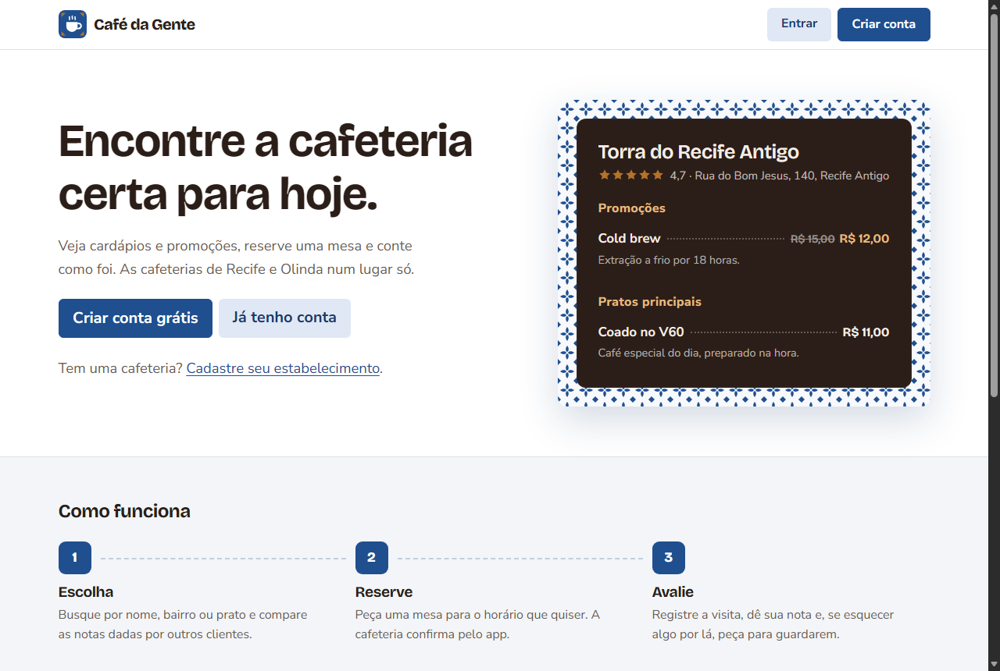
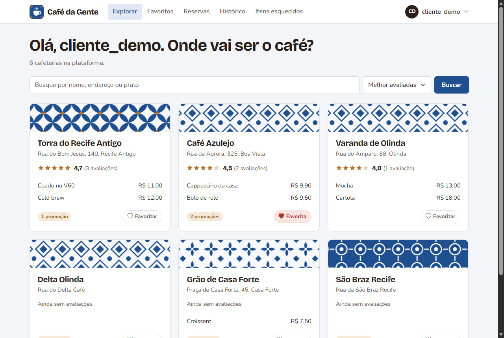
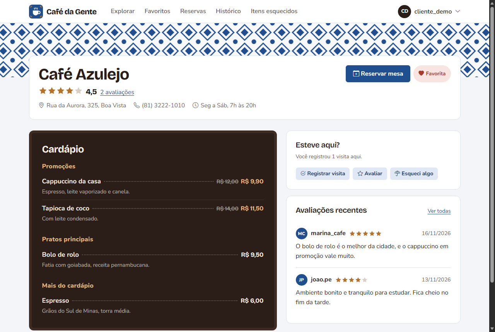
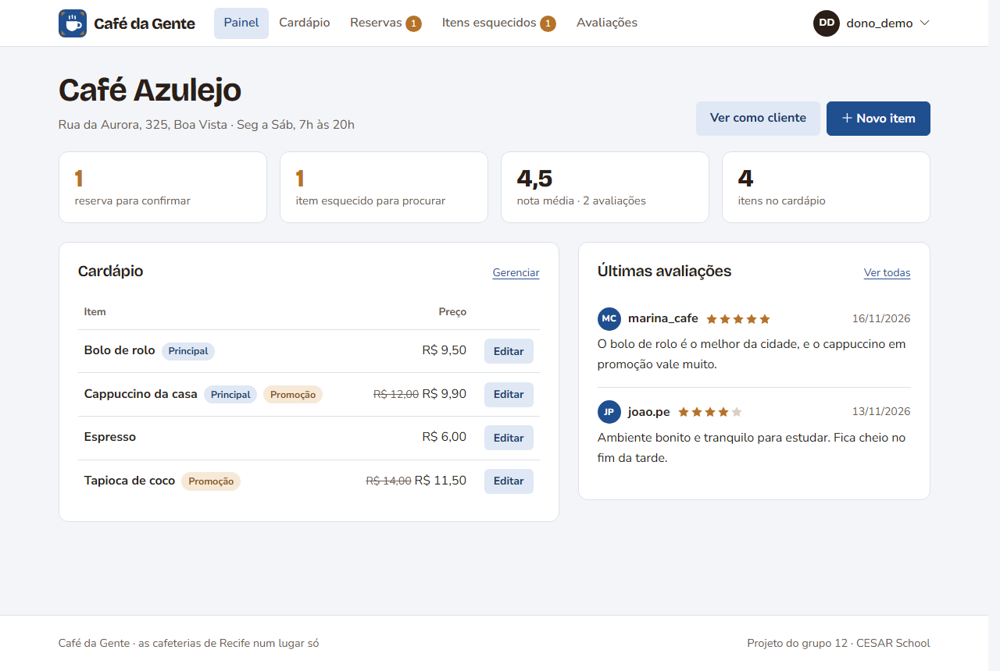

# Café da Gente

Plataforma web que conecta quem gosta de café às cafeterias de Recife e Olinda. O cliente encontra cafeterias, consulta cardápios e promoções, reserva mesas e avalia as visitas. O dono da cafeteria publica o estabelecimento, gerencia o cardápio e responde reservas e pedidos de itens esquecidos.

Projeto do grupo 12 da disciplina Projetos 2 da CESAR School (repositório `Coffee12`).



## Objetivo

Hoje, para escolher uma cafeteria, o cliente junta informações de várias fontes: perfis em redes sociais, mensagens para reservar mesa e avaliações espalhadas. Do outro lado, o dono de uma cafeteria pequena não tem um canal simples para divulgar o cardápio, destacar promoções e receber reservas.

O Café da Gente reúne essas duas pontas num só lugar:

- **Para o cliente:** descobrir cafeterias, comparar notas, ver o cardápio antes de sair de casa, garantir uma mesa e recuperar algo que esqueceu por lá.
- **Para o dono:** ter uma página pública da cafeteria, manter o cardápio atualizado, destacar pratos e promoções e acompanhar reservas, avaliações e pedidos dos clientes num painel.

## Funcionalidades

Há dois tipos de conta, cada um com a própria navegação e permissões.

### Cliente

| Funcionalidade | O que faz |
| --- | --- |
| Explorar cafeterias | Lista todas as cafeterias com nota média, pratos principais e promoções. Busca por nome, endereço ou prato e ordena por nota ou nome. |
| Perfil da cafeteria | Endereço, telefone, horário, cardápio completo (promoções, pratos principais e demais itens) e avaliações recentes. |
| Favoritos | Salva cafeterias para acesso rápido. |
| Reserva de mesa | Pede uma mesa para data, horário e número de pessoas. Acompanha o status (aguardando, confirmada, recusada, cancelada) e pode alterar ou cancelar. |
| Histórico de visitas | Registra a passagem por uma cafeteria e lista as visitas anteriores. |
| Avaliações | Dá nota de 1 a 5 estrelas com comentário. A média aparece no perfil e na busca. |
| Itens esquecidos | Pede à cafeteria que procure um objeto esquecido e acompanha a resposta. |

### Dono de cafeteria

| Funcionalidade | O que faz |
| --- | --- |
| Cadastro da cafeteria | Nome, endereço, telefone e horário de funcionamento, que podem ser editados depois. A cafeteria também pode ser excluída. |
| Painel | Resume as reservas para confirmar, os itens esquecidos para procurar, a nota média, o cardápio e as últimas avaliações. |
| Cardápio | Adiciona, edita e remove itens. Cada item tem preço, preço promocional opcional e pode ser destacado como prato principal. |
| Reservas | Confirma ou recusa pedidos de mesa e vê as reservas confirmadas dos próximos dias. |
| Itens esquecidos | Marca cada pedido como encontrado ou não encontrado. O cliente vê a resposta na hora. |
| Avaliações | Vê todas as avaliações com a distribuição das notas. |

| Explorar | Perfil da cafeteria | Painel do dono |
| --- | --- | --- |
|  |  |  |

## Especificações

### Tecnologias

| Camada | Tecnologia |
| --- | --- |
| Linguagem | Python 3.12 |
| Framework | Django 5.0 (views baseadas em função, templates do Django, formulários do Django) |
| Banco de dados | SQLite em desenvolvimento, PostgreSQL em produção |
| Interface | HTML com templates do Django, Bootstrap 5.3 e Bootstrap Icons via CDN, CSS próprio em `coffee12app/static/css/app.css` |
| Arquivos estáticos | WhiteNoise |
| Servidor em produção | Gunicorn no Azure App Service |
| Testes | `django.test` (testes unitários e de fluxo) |

### Modelo de dados

| Modelo | Descrição |
| --- | --- |
| `CustomUser` | Usuário com papel `CL` (cliente) ou `CM` (dono de cafeteria), telefone, cafeteria (para donos) e cafeterias favoritas. |
| `Estabelecimento` | A cafeteria: nome, endereço, telefone, horário e proprietário. Calcula a nota média. |
| `Prato` | Item do cardápio: nome, descrição, preço, preço promocional opcional e destaque como prato principal. |
| `Feedback` | Avaliação do cliente: nota de 1 a 5, comentário e data. |
| `Reserva` | Pedido de mesa: data e horário, número de pessoas e status (pendente, aceito, recusado, cancelado). |
| `Historico` | Visita registrada por um cliente numa cafeteria. |
| `ItemEsquecido` | Pedido para procurar um objeto, com status (pendente, achado, não encontrado). |

### Regras de negócio

- Todas as páginas, exceto a inicial, o login e o cadastro, exigem login.
- Áreas de cliente e de dono são separadas. Quem tenta abrir a área do outro papel é redirecionado com um aviso.
- Cada dono só vê e altera a própria cafeteria, o próprio cardápio, as reservas e os pedidos recebidos.
- Cada cliente só vê e altera as próprias reservas, visitas e pedidos.
- Ações que alteram dados (excluir, confirmar, cancelar, favoritar) só aceitam POST com token CSRF.
- Reservas precisam ser para um horário futuro, com 1 a 30 pessoas. Uma reserva alterada pelo cliente volta para "aguardando confirmação".
- O preço promocional, quando informado, precisa ser menor que o preço normal.
- A nota da avaliação vai de 1 a 5.
- Interface em português do Brasil, com fuso horário de Recife (`America/Recife`).

### Estrutura do projeto

```
Coffee12/
├── coffee12/                    # projeto Django
│   ├── manage.py
│   ├── requirements.txt
│   ├── coffee12/                # settings, urls, wsgi
│   ├── coffee12app/             # aplicação principal
│   │   ├── models.py            # modelos de dados
│   │   ├── views.py             # páginas e regras de permissão
│   │   ├── forms.py             # formulários e validações
│   │   ├── context_processors.py
│   │   ├── templatetags/        # filtros de moeda, nota e estrelas
│   │   ├── management/commands/popular_demo.py
│   │   ├── static/css/app.css   # design system
│   │   └── tests.py
│   └── templates/               # base.html, páginas e partials/
└── docs/telas/                  # capturas de tela usadas neste README
```

## Como rodar localmente

Requer Python 3.12.

```bash
python -m venv .venv
.venv\Scripts\activate          # no Linux/macOS: source .venv/bin/activate
pip install -r coffee12/requirements.txt
cd coffee12
python manage.py migrate
python manage.py popular_demo    # opcional: cafeterias, cardápios e avaliações de exemplo
python manage.py runserver
```

Acesse http://127.0.0.1:8000. Com os dados de demonstração, entre como `cliente_demo` ou `dono_demo` (senha `cafe-demo-2024`).

### Testes

```bash
cd coffee12
python manage.py test coffee12app
```

Os testes cobrem cadastro e login, permissões entre papéis, reservas, cardápio, avaliações e itens esquecidos.

### Produção

Defina `TARGET_ENV=prod` e as variáveis abaixo. Sem `TARGET_ENV`, o projeto roda em modo de desenvolvimento com SQLite.

| Variável | Uso |
| --- | --- |
| `SECRET_KEY` | Chave secreta do Django |
| `ALLOWED_HOSTS` | Domínios aceitos, separados por espaço |
| `CSRF_TRUSTED_ORIGINS` | Origens confiáveis, separadas por espaço |
| `DBNAME`, `DBHOST`, `DBUSER`, `DBPASS` | Conexão com o PostgreSQL |
| `DEBUG`, `SECURE_SSL_REDIRECT` | Opcionais (`true`/`false`) |

Antes do deploy, rode `python manage.py collectstatic`. A versão publicada pelo grupo ficava em https://cafedagente.azurewebsites.net.

## Histórico do projeto

O projeto nasceu na disciplina Projetos 2 da CESAR School, a partir de histórias de usuário e cenários BDD definidos pelo grupo. As histórias implementadas foram: pedir itens esquecidos, remover itens do cardápio, avaliar cafeterias, destacar pratos principais e promoções, cadastrar e editar o perfil da cafeteria, reservar mesas, favoritar cafeterias, ver avaliações recebidas e consultar o histórico de visitas.

Em 2026 a aplicação passou por uma revisão completa, mantendo a mesma stack: novo layout e identidade visual, correção de bugs, regras de permissão, validação de formulários e testes automatizados.

